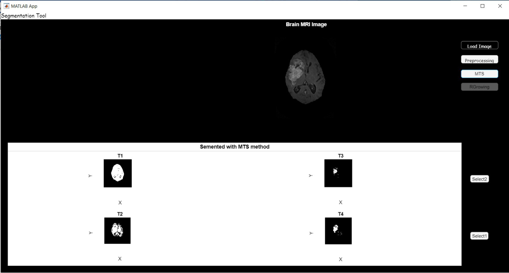
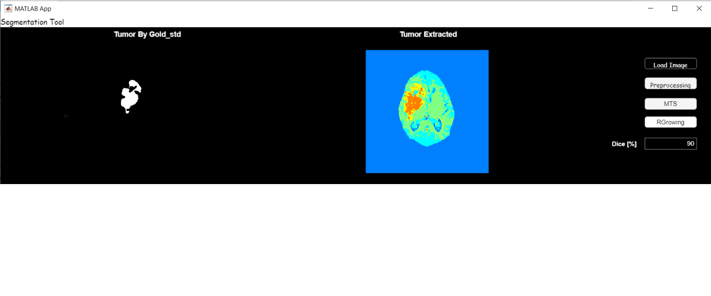

# Brain tumour segmentation in MRI (MATLAB)

Project for **Strumentazione Avanzata per Diagnosi e Terapia** (Advanced Instrumentation for Diagnosis and Therapy), M.Sc. Biomedical Engineering, University of Naples Federico II, 2022.

Segmentation of glioblastoma in contrast-enhanced T1-weighted MRI slices and quantitative comparison with a manually built **gold standard** using the **Dice coefficient**. A MATLAB App Designer GUI wraps the whole pipeline.

| Multi-threshold segmentation | Comparison with gold standard |
| --- | --- |
|  |  |

## Pipeline

1. **Pre-processing**: high-pass + median filtering to enhance edges and remove noise.
2. **Skull stripping** (`Skull_remove.m`): morphological operators combined with thresholding.
3. **Segmentation** (`Main_tesina_SADT.m`), comparing several methods:
   - intensity based: manual histogram threshold, Otsu, adaptive threshold, **multi-threshold (MTS)**;
   - region based: **region growing** from a seed point (`Region_growing.m`), manual ROI, k-means clustering.
4. **Tumour area** (`Tumor_area.m`) and **Dice score** against the gold standard.

## Gold standard

For each of the 8 slices the tumour was outlined by hand at least 4–5 times; the binary masks (`gold_standard/IMGx/roi*.mat`) are averaged into `Gold_stdx.mat` (`Gold_standard.m`).

## Repository layout

| Path | Content |
| --- | --- |
| `src/` | Processing scripts (`Main_SADT_Dicom*.m` work directly on DICOM files) |
| `app/SegmentationTool.mlapp` | App Designer GUI: load image → pre-processing → MTS / region growing → Dice |
| `gold_standard/` | Manual ROIs and averaged gold-standard masks |
| `docs/app_user_guide.pdf` | Step-by-step guide with results on all images (Italian) |

> The MRI DICOM images used in the course are not redistributed here.

## Skills

MATLAB · Image Processing Toolbox · App Designer · medical imaging (MRI, DICOM) · segmentation · morphological processing · validation metrics
